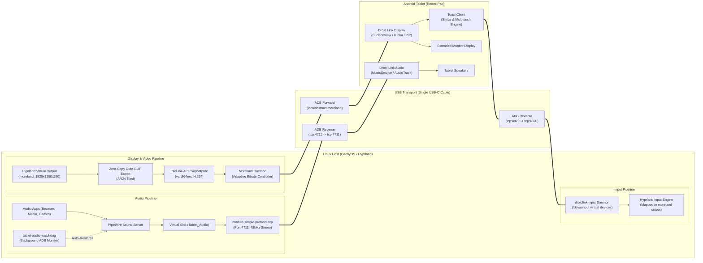

# DroidLink

> Turn an Android tablet into a high-performance extended desktop monitor and dedicated external audio endpoint over a single USB cable on Linux (CachyOS / Hyprland).

[](LICENSE)
[]()
[]()

**DroidLink** is an integration suite engineered by [Rayhan Khan](https://github.com/Rayhan-099) that seamlessly bridges Linux (Wayland / Hyprland) with Android tablets. It provides an **independent extended desktop display** (not screen mirroring) with hardware-accelerated video encoding, alongside **ultra-low latency PCM audio streaming** routed directly to the tablet's hardware speakers, backed by automatic fail-safe audio restoration.

---

## Features

- **Genuine Extended Desktop**: Creates an independent Wayland workspace on the tablet (tested at `1920×1200@90Hz` scaled to native `2560×1600`), allowing separate windows to be moved freely across displays.
- **Hardware-Accelerated H.264 Video**: Zero-copy DMA-BUF capture via Intel VA-API (`vah264enc`) and AMD VCN with runtime dynamic adaptive bitrate scaling (5–30 Mbps).
- **Wayland Touch & Stylus Input**: Full stylus pressure, tilt, barrel buttons, and multi-touch redirection from Android's digitizer directly into Hyprland via virtual uinput devices mapped to the extended monitor.
- **Picture-in-Picture & Surface Lifecycle**: Android Display client supports dynamic surface re-binding and native Picture-in-Picture, preventing stream drops when switching apps.
- **Ultra-Low Latency USB Audio**: Pure TCP streaming (48kHz 16-bit stereo PCM) with `< 20ms` latency directly through ADB reverse port forwarding.
- **Automatic Audio Restoration**: Automatically saves your active sound card before routing to the tablet and restores it instantaneously when streaming stops or the cable is unplugged.
- **Background Disconnect Watchdog**: Real-time non-busy monitor that prevents audio dropouts or zombie virtual devices upon unexpected disconnection.
- **Multi-Tablet Discovery**: Automatic single-device resolution, explicit serial targeting (`-d / --device <SERIAL>`), and isolated state per device.
- **Waybar & Desktop Integration**: Fast, non-blocking custom Waybar status module (`tablet-waybar`) with click-to-toggle actions and `.desktop` application launchers.
- **Single Cable Convenience**: Video, audio, and input streams multiplexed over a single standard USB-C data cable.
- **Clean User-Space Tooling**: No kernel modules, zero root privileges required during runtime, and zero modification to your system audio configuration.

---

## Architecture



Video, audio, and input pipelines operate as **completely independent streams**: you can toggle audio on and off without flickering or interrupting the extended desktop, and input events inject seamlessly into your compositor.

---

## Quick Start

```bash
# 1. Start the extended display
tablet

# 2. Route desktop audio to tablet speakers
tablet audio

# 3. Check live connection, display, audio, and device status
tablet status

# 4. Stop audio and restore laptop speakers
tablet audio stop

# 5. Stop display and clean up
tablet stop
```

---

## Command Reference

| Command | Action |
| :--- | :--- |
| `tablet` *(or `tablet start`)* | Starts the Moreland extended display service only. Laptop audio remains unaffected. |
| `tablet -d <SERIAL> start` | Targets a specific tablet serial when multiple Android devices are connected. |
| `tablet devices` | Lists all connected ADB devices, authorizations, models, and active DroidLink streams. |
| `tablet audio` *(or `tablet audio start`)* | Starts tablet audio streaming, launches Android receiver, routes PC audio, and starts the watchdog. |
| `tablet audio stop` | Stops audio streaming, shuts down Android player, and **restores laptop audio to your saved default sink**. |
| `tablet input start` | Starts the `droidlink-input` uinput daemon for tablet touch and stylus redirection into Hyprland. |
| `tablet input stop` | Stops the touch/stylus input bridge daemon. |
| `tablet stop` | **All-in-one cleanup**: Stops input and audio (if active), restores laptop audio, and shuts down the extended display service. |
| `tablet status` | Reports live status of the display daemon, ADB USB connection, audio stream, and active default sink. |
| `tablet restart` | Restarts the Moreland display service without disturbing active audio routing. |
| `tablet-waybar status` | Emits JSON formatted for Waybar custom modules (`{"text": "...", "class": "..."}`). |

---

## Waybar & Desktop Integration

DroidLink includes an ultra-fast Waybar module for monitoring and toggling display/audio directly from your status bar:

```jsonc
// Add to your ~/.config/waybar/config.jsonc:
"custom/droidlink": {
    "exec": "tablet-waybar status",
    "return-type": "json",
    "interval": 2,
    "on-click": "tablet-waybar toggle-display",
    "on-click-right": "tablet-waybar toggle-audio",
    "on-click-middle": "tablet-waybar stop-all",
    "tooltip": true
}
```

Sample configuration and stylesheets are located in [`examples/waybar/`](examples/waybar/).

---

## Prerequisites & Supported Environments

### Tested Hardware & Environment
- **Operating System**: CachyOS / Arch Linux (x86_64, Linux kernel 7.2+)
- **Compositor**: Hyprland 0.50+ (Wayland)
- **Audio Server**: PipeWire 1.0+ with WirePlumber
- **GPU**: Intel Iris Plus Graphics G1 / Intel Xe / AMD Radeon (VA-API H.264 supported)
- **Tablet**: Redmi Pad (Android 14 / Xiaomi HyperOS 1.0, 2560×1600 resolution)
- **Connection**: USB-C 3.0 / 3.1 data cable

### Dependencies
Install the required tools through `pacman`:

```bash
sudo pacman -S android-tools pulseaudio-utils gstreamer gst-plugins-base gst-plugins-good gst-plugins-bad gst-plugin-va python
```

---

## Installation

### 1. Clone DroidLink
```bash
git clone https://github.com/Rayhan-099/droid-link.git
cd droid-link
```

### 2. Configure uinput Permissions (For Touch & Stylus)
To allow non-root injection of virtual touch and pen events into Wayland:
```bash
sudo ./scripts/setup-uinput.sh
```

### 3. Run the Installer
```bash
./scripts/install.sh
```
This installs all CLI utilities (`tablet`, `tablet-audio`, `tablet-audio-watchdog`, `droidlink-device`, `droidlink-input`, `tablet-waybar`) into `~/.local/bin`, installs desktop launchers, and copies systemd user services.

### 4. Build Moreland with Intel VA-API & Adaptive Bitrate Patch
For Intel Iris Plus / Xe graphics and dynamic bitrate modulation:

```bash
git clone https://github.com/adiimanav/moreland.git ~/Repos/moreland
cd ~/Repos/moreland
git apply /path/to/droid-link/patches/moreland-intel-vaapi-dmabuf.patch
cargo build --release
cp target/release/moreland ~/.local/bin/
```

### 5. Build & Install Android Companion Apps
Droid Link includes first-party, reproducibly buildable Android companion apps under `android/`:
- **Droid Link Display** (`io.github.rayhan099.droidlink.display`): High-framerate H.264 rendering surface with stylus/touch digitization and Picture-in-Picture support.
- **Droid Link Audio** (`io.github.rayhan099.droidlink.audio`): Low-latency TCP PCM audio receiver.

Build both release APKs with a single command:
```bash
cd android
./gradlew assembleRelease
```
Install them to your connected tablet:
```bash
adb install -r display/build/outputs/apk/release/display-release.apk
adb install -r audio/build/outputs/apk/release/audio-release.apk
```
*(Legacy upstream apps `com.moreland.display` and `com.kaytat.simpleprotocolplayer` remain fully supported via seamless automatic fallback).*

---

## How Audio Routing Works

```
1. Active Default Sink (e.g. C-Media USB Audio)
      ↓ (User runs 'tablet audio')
2. Saved to ~/.config/tablet/<SERIAL>/saved_sink
      ↓
3. Dynamic PipeWire Module Loaded: module-null-sink (Tablet_Audio)
      ↓
4. PipeWire TCP Server: module-simple-protocol-tcp (port 4711, s16le 48000Hz)
      ↓
5. ADB Reverse Forwarding: adb reverse tcp:4711 tcp:4711
      ↓
6. Tablet Player Launched via Intent: io.github.rayhan099.droidlink.audio.action.PLAY
      ↓
7. System Default Sink switched to Tablet_Audio
      ↓
8. Existing audio playback streams migrated to Tablet_Audio
      ↓
9. Disconnect Watchdog background monitor armed
```

When you run `tablet audio stop` or unplug the tablet, DroidLink performs a clean teardown:
- Reads `saved_sink` and restores it as the system default sink.
- Migrates active playback streams back to your laptop speakers.
- Unloads `module-simple-protocol-tcp` and `module-null-sink`.
- Shuts down the Android receiver and cleans up ports.

---

## Testing & Verification

DroidLink includes an automated test suite verifying CLI behavior, device discovery, input handling, adaptive bitrate, and PipeWire routing mechanics:

```bash
./tests/test_cli.sh
./tests/test_device_discovery.sh
python3 tests/test_input.py
python3 tests/test_bitrate.py
./tests/test_audio_routing.sh
```

All integration features were empirically tested and verified:
- [x] **Extended Display**: True independent workspace moving windows seamlessly between screens.
- [x] **Adaptive Bitrate**: Dynamic bitrate scaling between 5,000 and 30,000 kbps based on client ACK RTT.
- [x] **Touch & Stylus Input**: Zero-latency uinput event bridge with pressure, tilt, and multi-touch support.
- [x] **USB Audio Playback**: Over 2.8 million frames rendered through tablet hardware speakers.
- [x] **Manual Restoration**: Instant fallback to laptop sound card with zero PipeWire residue.
- [x] **Automatic Disconnection**: Watchdog polls ADB every 2s and auto-restores audio within 4s of unplugging.
- [x] **Stream Independence**: Video, input, and audio can be started and stopped without affecting each other.

See [docs/testing.md](docs/testing.md) for detailed test logs.

---

## Documentation

- [docs/architecture.md](docs/architecture.md) — Detailed technical architecture and pipeline mechanics.
- [docs/installation.md](docs/installation.md) — Step-by-step setup and build guide.
- [docs/troubleshooting.md](docs/troubleshooting.md) — Solutions for common connection, input, and VA-API errors.
- [docs/testing.md](docs/testing.md) — Verification scenarios and test results.
- [android/README.md](android/README.md) — APK building, sideloading, and automation intents.

---

## Roadmap

- [x] Wayland touch and stylus input redirection from Android to Hyprland.
- [x] Direct system tray / Waybar widget for one-click display and audio toggling.
- [x] Robust auto-discovery and serial targeting for multi-tablet setups.
- [x] Dynamic bitrate adjustment based on client ACK round-trip time.
- [x] Picture-in-Picture mode and dynamic surface lifecycle management.
- [ ] Direct Wi-Fi / P2P transport mode for wireless operation when USB is disconnected.
- [ ] Reverse audio streaming (using tablet microphone as a Linux input source).
- [ ] Hardware AV1 / HEVC encoding profile support for newer GPUs and tablets.

---

## License & Attribution

- **DroidLink Integration & Scripts**: Released under the [MIT License](LICENSE). Copyright (c) 2026 [Rayhan Khan](https://github.com/Rayhan-099).
- Upstream projects and components are acknowledged in [THIRD_PARTY_NOTICES.md](THIRD_PARTY_NOTICES.md).
